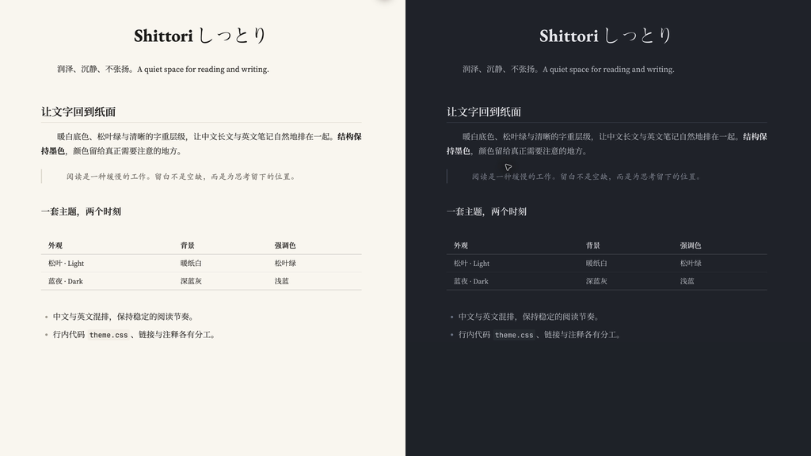

# Shittori しっとり

一套适合中文长文和中英混排笔记的 Obsidian 主题。浅色用暖纸白和松叶绿，深色用蓝灰和浅蓝；通过字号、字重和留白区分层级，让颜色留给链接、高亮和提示。

[全平台项目](https://github.com/ishixi233/shittori) · [下载](https://github.com/ishixi233/shittori-obsidian/releases/tag/1.0.0) · [反馈问题](https://github.com/ishixi233/shittori-obsidian/issues)

预览为 macOS 上 Obsidian 1.14.4 的实际阅读视图，裁剪后并排展示。截图环境另开了首行缩进 CSS 片段；主题本身不带首行缩进。其他桌面系统和移动端尚未实测。

## 安装

在社区目录收录前，可从 Releases 下载 `theme.css` 和 `manifest.json`，放入你的库目录 `.obsidian/themes/Shittori/`，再到「设置 → 外观 → 主题」选择 Shittori。浅深色由 Obsidian 的基础颜色设置控制。

最低版本为 Obsidian 1.8.0。主题支持阅读视图与实时预览，不要求安装其他插件。

## 字体

主题调用本机字体，不加载网络资源，也不附带字体文件。

- 中文正文：思源宋体 VF；英文正文：Source Serif 4。
- 一级标题：方正大标宋简体、EB Garamond。
- 强调：霞鹜文楷；引用：楷体-简；代码：JetBrains Mono。

未安装时会使用后备字体，显示效果因系统而异。方正字体需自行确认使用许可。希望减少字体差异时，可在 Style Settings 中启用「一级标题用正文字体」，或自行调整 `theme.css` 中的字体变量。

## 可选设置

安装 Style Settings 插件后，在「设置 → Style Settings → Shittori」中可调整三个选项：

- 加粗带强调色，默认关闭。
- 一级标题用正文字体，默认关闭。
- 正文两端对齐，默认关闭。

正文建议从 18px 开始按屏幕调整。主题默认左对齐，避免两端对齐把行内代码周围的字距拉开。

## 已知边界

中文与英文共用弯引号字形，英文弯引号可能显得偏宽。日文假名可正常显示；需要日文字形的汉字可放入带 `lang="ja"` 的片段。已有 CSS 片段和插件样式可能覆盖主题，排查时可暂时关闭它们。

## 许可

[MIT](LICENSE)。反馈时请附 Obsidian 版本、操作系统、阅读或编辑模式，以及最小复现示例。
