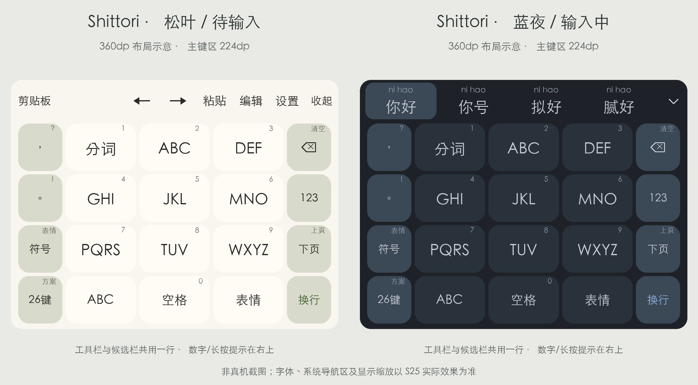

# Shittori · 同文九宫格

[← 项目说明](../../README.md)

适配 Android 同文 Trime 3.3.12 的拼音九宫格主题，按三星 Galaxy S25 的竖屏尺寸设计。暖白「松叶」和深蓝灰「蓝夜」配色，支持九宫格、26 键全拼、英文、数字、符号与独立编辑面板。

这是按 360dp 宽度和配置参数生成的布局示意，非手机截图。系统字体、显示缩放和导航区域以设备实际效果为准。

## 下载与依赖

[下载主题包](https://github.com/ishixi233/shittori/releases/tag/trime-2.0.0)

- [同文 Trime 3.3.12](https://github.com/osfans/trime/releases/tag/v3.3.12)，S25 使用官方 arm64-v8a APK。
- [雾凇拼音](https://github.com/iDvel/rime-ice)完整配置、字典、Lua 和 OpenCC 文件。本目录是主题与适配配置，不包含完整雾凇字库或语法模型。
- Android 系统默认字体；候选编号配置 JetBrains Mono，字体及 OFL 许可已附带。

## 安装

1. 在同文选定的外部同步目录中准备好雾凇拼音，目录内应能直接看到 `rime_ice.schema.yaml`、`rime_ice.dict.yaml`、`cn_dicts/`、`lua/` 和 `opencc/`。
2. 将本目录 `rime/` 中的内容合并到该目录。已有同名 `default.custom.yaml`、`rime_ice.custom.yaml` 时合并各自 `patch:` 中的设置，不能出现两个顶层 `patch:`。已有私人短语文件时保留原文件；本包中的两个短语文件只有格式注释。
3. 在同文重新部署，方案选择「Shittori · 雾凇九宫格」，主题选择「Shittori · S25 九宫格」（文件名 `shittori`）。26 键方案为「Shittori · 雾凇全拼（26键）」。
4. 配色选择「Shittori · 自动浅深色」，开启同文的跟随系统夜间模式；也可手动选择松叶或蓝夜。
5. **常规 → 嵌入式预编辑模式：保持“禁用”。** 主题隐藏独立编码浮条，拼音显示在候选上方；若改成“组合文本”，输入框里仍可能出现内部数字编码。
6. 虚拟键盘中不要开启“隐藏输入栏”或“隐藏按键符号”，否则工具栏或右上角提示会消失。外部文件改动后需重新部署。

同文外部目录是同步位置，应用内部还有数据副本。已安装本主题时，只更新 `shittori.trime.yaml`、`shittori_t9.schema.yaml`、`lua/shittori_t9_preedit.lua` 即可；保留原有字库、私人短语和 custom 补丁。

## 操作

| 入口 | 功能 |
|---|---|
| 顶部剪贴板 | 直接打开同文原生剪贴板 |
| 顶部 ← / → | 移动光标；空格左右滑动也可移动 |
| 顶部粘贴 | 粘贴剪贴板内容 |
| 顶部编辑 | 全选、复制、剪切、粘贴、四向光标、行首行尾、选区、撤销、重做 |
| 顶部设置 / 收起 | 同文菜单 / 隐藏键盘 |
| 字母键 | 按九宫格输入拼音；右上角数字为长按输入 |
| 分词 / 长按分词 | 插入拼音音节分隔 / 输入 1 |
| 空格 / 长按空格 | 选择首个候选 / 输入 0 |
| 退格 / 长按退格 | 删除 / 清除当前组合 |
| 下页 / 长按下页 | 下一页 / 上一页候选 |
| 26键 / 九宫 | 在中文全拼与九宫格间切换 |
| ABC / 123 / 符号 / 表情 | 对应独立键盘或表情页 |

输入时顶部工具栏切换成候选栏，完成选词后恢复，不额外占用一行。应用的剪贴板建议或密码填充建议可能临时占用中间工具区；可在同文设置关闭相应建议。编辑动作对已提交文本使用，具体效果取决于所在应用对 Android 编辑命令的支持。

中文 Emoji 候选默认开启；没有添加 an/ang 互换模糊音。九宫格本身存在同编码歧义，可用分词、先选短词或切换全拼解决。本方案没有三星式动态拼音筛选栏、滑行输入、语音引擎或云联想。

## 尺寸与调整

| 参数 | 值 |
|---|---|
| 主键区高度 | 224dp；横屏 176dp |
| 候选/工具栏 | 46dp，共用一行 |
| 九宫格字母 / 候选文字 | 17sp / 17sp |
| 候选拼音 / 按键提示 | 9sp / 8sp |
| 按键圆角 | 12dp |
| 候选高亮圆角 | 9dp |
| 底部主题留白 | 4dp |

总高度修改 `style/keyboard_height`；字号修改 `style/candidate_text_size` 及具体按键的 `key_text_size`。数字与长按提示使用 `label_symbol` 和每键 `key_symbol_offset_x/y`。同文按总高度缩放各行，只改 `key_height` 不会改变整块键盘高度。三星系统导航区不受主题控制。

## 文件与兼容

`rime/` 包含主题、九宫格方案、预编辑 Lua、全拼/默认方案补丁、空白私人短语模板和编号字体。完整词库由雾凇提供，手机用户数据库由同文维护。不要直接复制 macOS 的 build、userdb 或设备标识文件。

配置按 Trime 3.3.12 官方源码核对；已通过 YAML、行宽、动作引用检查，以及真实桌面 librime 的中文、Emoji、短语和方案切换测试。尚未在 S25 或 Android 模拟器运行，不将桌面测试视为手机 UI 实测。

## 参考与许可

以[同文默认主题](https://github.com/osfans/trime/blob/v3.3.12/app/src/main/assets/shared/trime.yaml)和原生工具栏为兼容依据，布局参考 [rime-pure](https://github.com/SivanLaai/rime-pure) 与[单静](https://github.com/nopdan/danjing)，功能入口参考[三星键盘工具栏](https://www.samsung.com/us/support/answer/ANS10001592/)。主题派生部分沿用 GPL-3.0-or-later，JetBrains Mono 使用 OFL；许可原文见 `licenses/`。
